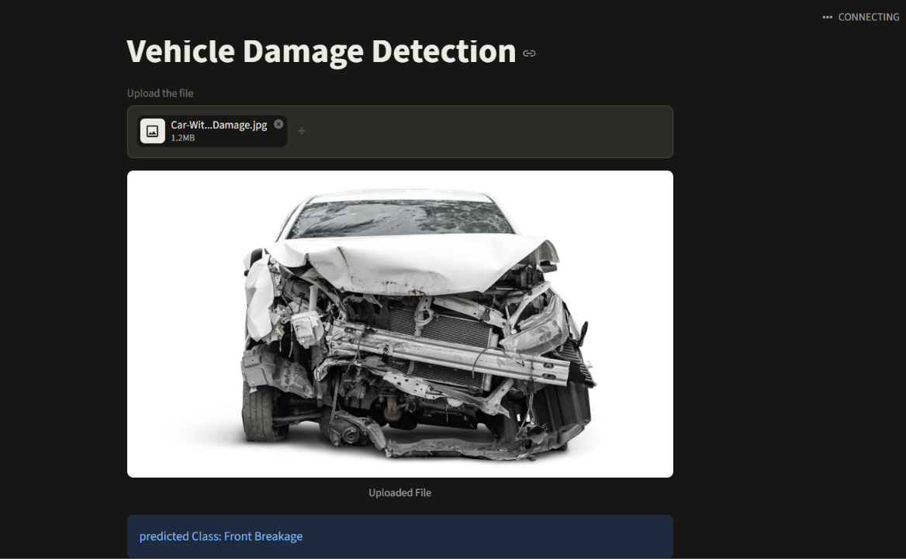

# Vehicle Damage Detection

This project checks a vehicle photo and predicts its damage category using a trained **ResNet50** deep-learning model.




## Application screenshot

This is an example of the Streamlit interface after uploading a vehicle image and receiving a prediction.


## What does this project do?

1. You upload a vehicle photo (JPG or PNG).
2. FastAPI receives the photo.
3. The image is prepared for the ResNet50 model.
4. The model predicts one of the six categories.
5. The API returns the predicted category and confidence score.

### Damage categories

- Front Breakage
- Front Crushed
- Fronted Normal
- Rear Breakage
- Rear Crushed
- Rear Normal

The category names and their order must match the labels used when the model was trained. `Fronted Normal` is kept as it appears in the supplied project files.

## 1. Project folder

After extracting the ZIP file, the folder should look like this:

```text
vehicle_damage_fastapi/
│
├── main.py                 # FastAPI application
├── model_helper.py         # Loads the model and predicts damage
├── requirements.txt        # Required Python packages
├── README.md               # Project guide
├── assets/
│   └── vehicle_damage_example.png
└── models/
    └── saved_model.pth     # Your trained model
```

**Important:** Keep `saved_model.pth` inside the `models` folder. Do not rename it unless you also change the model path in the project.

## 2. Open the project in PyCharm

1. Extract `vehicle_damage_fastapi_project.zip`.
2. Open PyCharm.
3. Select **Open**.
4. Choose the extracted `vehicle_damage_fastapi` folder.
5. Wait for PyCharm to load the project.

## 3. Set up Python

Open the PyCharm **Terminal** at the bottom.

1. Create a virtual environment for this project.
2. Activate it.
3. Install the packages listed in `requirements.txt`.

Use these commands in Windows PowerShell, one at a time:

```powershell
python -m venv .venv
.\.venv\Scripts\Activate.ps1
python -m pip install --upgrade pip
python -m pip install -r requirements.txt
```

If PowerShell does not allow activation, use the virtual environment's Python directly:

```powershell
.\.venv\Scripts\python.exe -m pip install -r requirements.txt
```

PyTorch and Torchvision must be compatible with each other and with your Python version. If installation fails, use the official PyTorch installation selector to choose the CPU build for a CPU-only laptop.

## 4. Start the API

In the same Terminal, make sure you are in the folder containing `main.py`. Then start the server:

```powershell
python -m uvicorn main:app --reload
```

When it starts successfully, keep that Terminal open.

## 5. Open the API page

Open this address in your browser:

**http://127.0.0.1:8000/docs**

This page is called Swagger UI. It lets you test the API without building another screen.

## 6. Test a vehicle image

1. Find **POST /predict**.
2. Open it.
3. Click **Try it out**.
4. Click **Choose File** and select a JPG or PNG vehicle photo.
5. Click **Execute**.
6. Check the response for the predicted category and confidence.

You can also open **GET /health** and click **Try it out**, then **Execute**, to check whether the API is running.

## 7. Connect it to the Streamlit screen

Run the FastAPI server in one PyCharm Terminal. Run your Streamlit application in a second Terminal. The Streamlit screen sends the uploaded photo to the FastAPI address at `http://127.0.0.1:8000/predict`.

Both applications must be running at the same time for this connection to work.

## Simple project flow

**Vehicle photo → FastAPI → Image preparation → ResNet50 model → Damage category + confidence**

## Important notes

- This project classifies the whole image into one of six categories.
- It does not mark the exact damaged area with a box.
- It does not calculate repair costs.
- The confidence score is the model's score, not a guarantee that the prediction is correct.
- Prediction quality depends on the quality and variety of the images used to train the model.

## Common problems

**Model file not found:** Check that `models/saved_model.pth` exists.

**Package not found:** Check that the project's `.venv` is active, then install the requirements again.

**Address already in use:** Another application may be using port 8000. Stop that application or start this API on another port.

**Prediction or model-loading error:** The saved checkpoint must have been created from the same ResNet50 model structure and six output classes used by `model_helper.py`.
